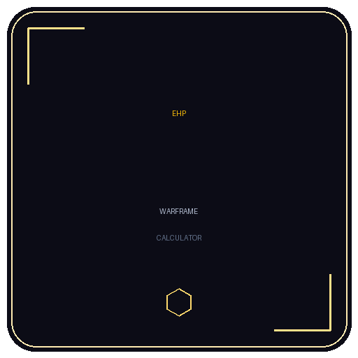

  

<h1 align="center">Warframe EHP Calculator</h1>

A single-page tool that computes a Warframe character's **Effective Health Pool (EHP)** from HP, Armor, Shields, Overguard, and ability-based damage reduction.

Includes a "With Adaptation (90% DR)" comparison so you can see how much the 10× multiplier is worth on your build.

## How it works
- All inputs update results in real time (no calculate button).
- Armor protects HP only; ability DR and Adaptation protect both HP and Shields.
- Overguard is a unique health type added flat (unaffected by any DR).

## Hosted on GitHub Pages
This repo is deployed as a static site. The app lives at the repository root (`index.html`).

## Local development
No build step or dependencies. Just open `index.html` in a browser.
